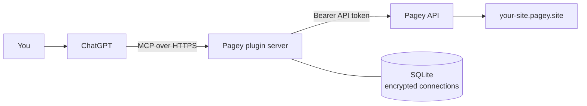

<div align="center">

# Pagey × ChatGPT

### Ask for a website. Get a live one.

**Publish static sites from a ChatGPT conversation — free, with no subscription, no credit card, and no cap on total sites.**

[](https://github.com/freakynit/chatgpt-pagey/actions/workflows/ci.yml)
[](LICENSE)
[](https://modelcontextprotocol.io)
[](https://nodejs.org)

[Live demo](https://chatgpt-demo.pagey.site) · [Pagey](https://pagey.site) · [API reference](https://pagey.site/api-docs) · [Deploy](docs/DEPLOY.md) · [Report an issue](https://github.com/freakynit/chatgpt-pagey/issues)

</div>

> **“Build a launch page for my indie analytics tool and publish it.”**
>
> Done — it’s live at `https://quiet-orbit.pagey.site`. Ask for a change and the same URL stays put.

Pagey for ChatGPT is an open-source MCP plugin that gives ChatGPT a real
publishing tool. Ask for a page, and ChatGPT writes the HTML and publishes it to
Pagey: automatic HTTPS, a `*.pagey.site` address, visitor analytics, password
protection, custom subdomains, and hosted forms.

**The first ChatGPT plugin built for Pagey — and a genuinely free alternative to
“deploy from chat” tools that meter sites, expire previews, or ask for a card.**
No subscription. No credit card. No cap on the number of sites you own.

<div align="center">

| Build | Publish | Share |
| :---: | :---: | :---: |
| ChatGPT writes the site in the conversation | One tool call uploads it to Pagey | A real `https://…pagey.site` link |

</div>

## Why this one is different

Most “AI website” tools give you a generated preview behind an account, a paywall,
or a temporary URL. Pagey is actual static hosting, and this plugin puts it inside
the conversation.

- **Truly free hosting.** A registered Pagey account gets automatic HTTPS, no
  card, and **no cap on total sites**.
- **Publish where you think.** No dashboard, build pipeline, cloud project, or
  deploy button. The conversation is the workflow.
- **The link survives edits.** `update_site` replaces the content in place and
  keeps the URL. No new deployment URL for every change.
- **More than a landing page.** Password-protected drafts, custom subdomains,
  expiring sites, maintenance mode, country rules, tags, analytics, and a form
  backend with stored responses.
- **Open and inspectable.** One readable TypeScript codebase, no telemetry, no
  third-party scripts, OAuth with encrypted tokens, and a Dockerfile for
  self-hosting.

## What you can ask

```text
Build a dark, one-page portfolio for a product designer and publish it.

Turn this README into a clean documentation site and publish it as docs-demo.

Update the pricing section on my site. Keep the same link.

Create a waitlist page with a working form, then show me the responses.

Password-protect my draft and make it expire on Friday.

How many people visited my site this week, and where did they come from?
```

The plugin writes real files, not screenshots. Single-page sites can be one
self-contained `index.html`; multi-file sites can include CSS, JavaScript,
images, fonts, and other static assets.

## Connect it

ChatGPT needs a public HTTPS endpoint. **This repository is that endpoint.**
Deploy it once, then connect ChatGPT to your deployment.

### 1. Deploy the server

The fastest path is Docker Compose with automatic HTTPS via Caddy:

```sh
git clone https://github.com/freakynit/chatgpt-pagey.git
cd chatgpt-pagey
cp deploy/.env.example .env
# Set MCP_DOMAIN=mcp.example.com in .env, and point DNS at the server
docker compose up -d --build
```

Open `https://mcp.example.com/healthz` — it should return `{"status":"ok"}`.
Full instructions for Docker, Nginx, Node, systemd, backups, and updates are in
[docs/DEPLOY.md](docs/DEPLOY.md).

### 2. Add the plugin in ChatGPT

1. Open ChatGPT → **Plugins** → **Add custom MCP server**.
2. Name it **Pagey**.
3. Server URL: `https://mcp.example.com/mcp`.
4. Authentication: **OAuth**.
5. Create the plugin. ChatGPT discovers the OAuth metadata automatically.

### 3. Connect your Pagey account

The first time ChatGPT uses a Pagey tool, it opens the Pagey connection page:

1. Create a free account at [pagey.site/signup](https://pagey.site/signup) if you
   do not have one.
2. Open [API tokens](https://pagey.site/dashboard/api-tokens) and create a token
   labeled **ChatGPT**.
3. Paste the token on the connection page. It is stored encrypted and sent only
   to Pagey’s API.

No Pagey password is ever requested. The token grants full access to your Pagey
account, so use a dedicated token and revoke it when you are done.

### 4. Publish

Start a chat with the Pagey plugin enabled:

```text
Build a one-page site for my coffee subscription and publish it.
```

ChatGPT writes a complete responsive page, calls `publish_site`, and returns the
live URL. Ask for changes and it calls `update_site` — same address, new content.

## What the plugin can do

| Tool | What it does |
| --- | --- |
| `publish_site` | Create a new site from HTML or a multi-file bundle. Returns the live URL. |
| `update_site` | Replace a site’s complete content at the same URL. |
| `list_sites` | Find sites by title or subdomain, with IDs, URLs, and status. |
| `get_site` | Read a site’s URL, title, expiry, tags, password state, and timestamps. |
| `update_site_settings` | Change title, password, expiry, custom subdomain, maintenance, tags, or country rules. |
| `get_site_analytics` | Page views, unique visitors, sessions, top pages, referrers, countries, devices, and traffic sources. |
| `create_form` | Create a hosted contact, waitlist, feedback, or survey form with a real backend. |
| `list_forms` | List forms with response counts and linked sites. |
| `get_form_responses` | Read or search submissions. |
| `whoami` | Show the connected Pagey account and site count. |
| `delete_site` | Permanently delete a site. Requires explicit confirmation. |

Destructive actions are annotated, and `delete_site` refuses to run without
`confirm: true`. ChatGPT can ask you before using write tools according to your
plugin confirmation settings.

## Free, honestly

Pagey’s offer is unusually straightforward, and the plugin does not hide it:

| Allowance | Free registered account |
| --- | --- |
| New sites | **25 per UTC day** |
| Total sites | **No cap** |
| Updates to an existing site | Do not use the new-site allowance |
| Upload size | **1,000 files / 50 MiB** per publish (plugin limit) |
| Analytics retention | **90 days** |
| Forms | **25 active / 5,000 submissions per month** |
| AI site builder (Pagey dashboard) | **5 sessions / 5 prompts per month** |

“Unlimited” means no cap on total sites, not unlimited bandwidth or infinite new
sites per day. Pagey also applies its own request and upload rate limits. Hosted
sites are static: no Node.js, PHP, SSR, or custom API server. Use Pagey’s hosted
forms for a form backend. See [pagey.site/llms.txt](https://pagey.site/llms.txt)
for the current source of truth.

## How it works



- ChatGPT speaks the open [Model Context Protocol](https://modelcontextprotocol.io)
  over Streamable HTTP.
- The plugin server owns the OAuth flow and forwards tool calls to Pagey’s REST
  API. It never proxies site traffic; Pagey serves the sites directly.
- One Pagey account maps to one encrypted connection. OAuth tokens are stored as
  hashes, refresh tokens rotate, and authorization codes are single-use.
- The server is stateless for MCP requests and keeps only connection/OAuth state
  in SQLite. Run one replica with one persistent volume.

## Security and privacy

- The Pagey API token is encrypted at rest with AES-256-GCM. The key comes from
  `PAGEY_MCP_SECRET` or is generated once in `DATA_DIR/secret`.
- Request bodies, API tokens, and OAuth tokens are never logged.
- The OAuth form uses PKCE, a signed HttpOnly cookie, and a per-form nonce.
- Uploads reject path traversal, hidden files, dependency folders, source maps,
  key material, databases, unsupported extensions, oversized content, and common
  credential patterns.
- The plugin collects no analytics and loads no third-party scripts.
- **A Pagey API token grants full account access.** Create a dedicated token,
  keep it out of chat, and revoke it when you stop using the connection.

Read [SECURITY.md](SECURITY.md) and [PRIVACY.md](PRIVACY.md) for the full
details.

## Development

Requires Node.js 24+ (the SQLite store uses the built-in `node:sqlite` module).

```sh
npm ci
npm run typecheck
npm test
npm run build
npm start
```

`npm test` runs the unit and integration suite, including an end-to-end OAuth +
MCP publish flow against an in-process fake Pagey API. No network or Pagey
account is needed.

Live validation against Pagey:

```sh
PAGEY_API_TOKEN=... npm run e2e
```

That script walks the real OAuth flow, publishes the demo page, updates it at the
same URL, exercises analytics and forms, and leaves the demo site online. The
current demo is [chatgpt-demo.pagey.site](https://chatgpt-demo.pagey.site).

### Local development with ChatGPT

ChatGPT cannot reach `127.0.0.1`. For a local test, expose the server through an
HTTPS tunnel and set `PUBLIC_BASE_URL` to the tunnel origin before starting:

```sh
PUBLIC_BASE_URL=https://your-tunnel.example.com npm run dev
```

Then add `https://your-tunnel.example.com/mcp` as a custom MCP server. Use a
tunnel you trust; it sees the same OAuth and site traffic as your server.

### Project layout

```text
src/
  auth/       OAuth provider, DCR clients, SQLite store, encrypted tokens
  http/       Express app, OAuth pages, landing page, privacy page
  mcp/        MCP server, tool schemas, server instructions
  pagey/      Pagey API client, upload validation, deterministic ZIP builder
scripts/      Live Pagey end-to-end check
examples/     The published demo page
test/         Unit and integration tests
docs/         Deployment guide
```

## Related plugins

- [herdr-pagey](https://github.com/freakynit/herdr-pagey) — publish from Herdr.
- [opencode-pagey](https://github.com/freakynit/opencode-pagey) — publish from OpenCode v2.
- [paseo-pagey](https://github.com/freakynit/paseo-pagey) — publish from Paseo.

## License

[MIT](LICENSE).

Pagey for ChatGPT is an independent open-source integration. It is not an
official OpenAI product. Pagey operates the hosting service and sets its own
terms, limits, and content policies.
